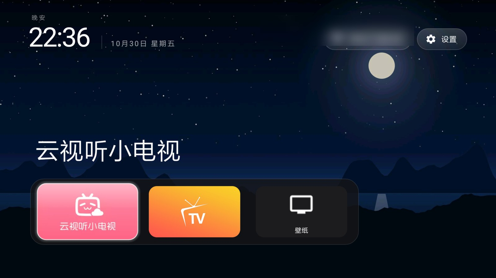
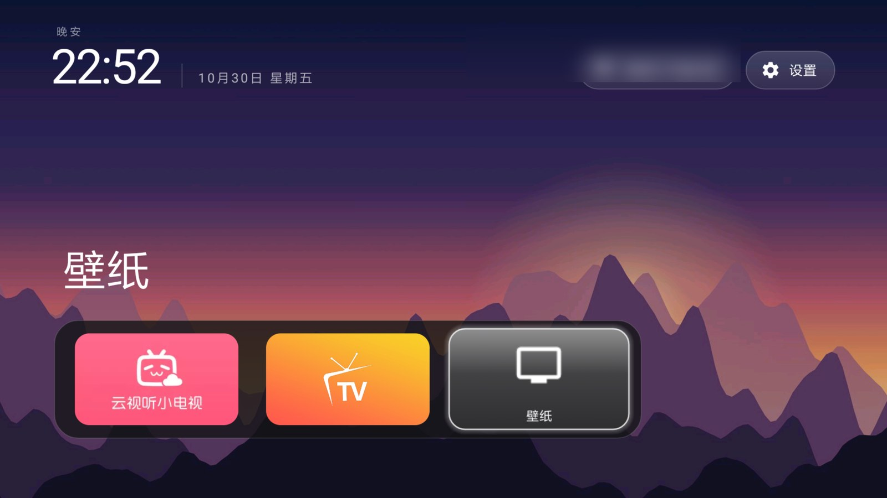

# MiTV2S-48 TV Home · tvOS-style launcher for Android 5.1 (API 22)

[简体中文](README.md) | English

A port of the [CleanYourTV](https://github.com/Gathin23/cleanyourtv) tvOS-style launcher to
**Android 5.1 (API 22)**, plus a tested recipe for a Xiaomi Mi TV 2S 48": reversible system
debloating with `pm hide`, Home takeover, wallpapers and vendor settings access.

Tested on a Xiaomi **MiTV2S-48 (gladiator, Android 5.1.1 / API 22)**: cold boot into the new Home,
the Home key, app launches, the Settings and Wi-Fi pills, the wallpaper picker and rotation, and the
restore path were all checked; `logcat -b crash` stayed empty.




*The Wi-Fi network name in the screenshots is blurred; the wallpaper is an illustration generated by
upstream's `tools/scenes_wallpapers.py`.*

## Why this port exists

| Problem | What this repository does |
|---|---|
| Upstream's launcher is `minSdk 26` (Android 8); this TV is API 22 | Ported to `minSdk 22`: core library desugaring, 48 `NewApi` calls replaced with real guards, R8 disabled (see [docs/api22-port.md](docs/api22-port.md)) |
| China Xiaomi firmware refuses `pm disable-user` for every package (`SecurityException`) | Uses `pm hide` instead: verifiable, reversible, survives a reboot; scripts in `scripts/` |
| The framework forces its own Home; selecting a third-party Home does nothing | Hides the stock launcher (`com.mitv.tvhome`), so HOME resolves to the new one; one `pm unhide` restores it |
| The network/ADB debugging switch lives only in the vendor settings app | The Settings pill opens the vendor app (`settings_pill_native`) |
| A simple Home that can change wallpaper is wanted | A wallpaper picker (thumbnail grid / daily rotation / none) and a dock `Wallpaper` button |

## Features

- **tvOS-style Home**: greeting, thin clock and date, frosted pills top right, the focused app's ambient
  colour from its banner, a dock band at the bottom
- **Wallpapers**: rotates the pictures in `files/wallpapers/` (daily by default), a thumbnail picker to
  choose one picture or turn them off, and a dock button that opens it
- **Home takeover** by hiding the stock launcher: boot, the Home key and returning from apps all work
- **Debloat**: a reversible hide list for 42 preinstalled/ad/telemetry packages (`lists/`)
- **24-hour clock**: `settings put system time_12_24 24`
- **Dock**: two apps (云视听小电视, 影视仓) plus the Wallpaper button; edit
  `launcher/app/src/main/res/values/config.xml` to change them

## Requirements

- A TV on Android 5.1 (API 22); tested on a Xiaomi MiTV2S-48. Network ADB on the same Wi-Fi
  (`adb connect <tv ip>:5555`)
- Build: JDK 17, Android SDK platform 34 + build-tools 34.0.0 (the Gradle wrapper downloads Gradle 8.9
  on first build)

## Build

```bash
cd launcher
export JAVA_HOME=/path/to/jdk17
export ANDROID_HOME=/path/to/android-sdk
./gradlew assembleRelease
# APK: app/build/outputs/apk/release/app-release.apk (~1.9 MB, debug-signed, sideload only)
```

A prebuilt APK **built from this source** is attached to the
[Releases](https://github.com/lucas-sys/mitv2s-48-tvhome/releases) page for convenience; the repository
itself stays source-only (no binaries in git).

## Install and take over Home

```bash
export TV_HOST=<tv ip>
scripts/install-launcher.sh launcher/app/build/outputs/apk/release/app-release.apk
# Try it first from 我的应用 ("My apps"); once it works, hand Home over:
scripts/install-launcher.sh launcher/app/build/outputs/apk/release/app-release.apk --take-home
```

`--take-home` runs `pm hide --user 0 com.mitv.tvhome` (hidden, not uninstalled) and stays in effect
across reboots. Restore the stock launcher with:

```bash
adb -s <tv ip>:5555 shell pm unhide --user 0 com.mitv.tvhome
adb -s <tv ip>:5555 shell input keyevent 3
```

## Debloating (optional, reversible)

```bash
scripts/hide.sh lists/01-ads-telemetry.txt
scripts/hide.sh lists/02-preloaded-apps.txt
scripts/hide.sh lists/03-account-cloud.txt
# undo everything:
scripts/restore-all.sh
```

The lists, the packages that must stay enabled and the other quirks of this TV (inputs, casting,
fonts, ADB closing after every reboot) are documented in **[docs/mitv2s-48.md](docs/mitv2s-48.md)**
(Chinese).

## Wallpapers

```bash
D=/sdcard/Android/data/com.gathin.tvhome/files
adb -s <tv ip>:5555 shell mkdir -p $D/wallpapers
adb -s <tv ip>:5555 push wallpapers/*.jpg $D/wallpapers/
adb -s <tv ip>:5555 push docs/wallpaper.example.json $D/config.json
```

`config.json` accepts `wallpaper_rotation_minutes` (0–1440; 1440 = daily), `wallpaper_order`
(`sequential` / `shuffle`), `wallpaper_dim`, `dock_opacity` and the other keys of the upstream theme
format. Wallpaper images can be taken from upstream's
[`themes/`](https://github.com/Gathin23/cleanyourtv/tree/main/themes); check the CC BY / CC BY-SA
credits in upstream's `CREDITS.md` before republishing photographs.

## Known limitations

- Only tested on a MiTV2S-48 (Android 5.1.1); other firmware will need its own checks
- **Network ADB closes after every reboot/standby** (firmware behaviour); re-enable it in the Xiaomi
  settings before the next session
- This TV's `TvInputManager` has no inputs at all, so the launcher's Inputs menu cannot list anything;
  open the source panel with `am start -n com.xiaomi.mitv.tvplayer/.ExternalSourceActivity`
- The Outfit font is an `@font` XML family that Android 5.1 cannot load; text falls back to the system
  font (adding AppCompat would fix it, but that is a new dependency this port does not take)
- R8 is off (its lambda desugaring crashed on API 22), so the APK is ~1.9 MB

## Licence and credits

- MIT, see [LICENSE](LICENSE).
- The launcher sources, tests and resources come from
  **[CleanYourTV](https://github.com/Gathin23/cleanyourtv)** (Copyright (c) 2026 Gathin, MIT); the
  API 22 port, the device notes and the scripts are by **lucas-sys**. See [CREDITS.md](CREDITS.md).
- Not affiliated with Xiaomi, Tencent or bilibili. No firmware, prebuilt binaries in git, or device
  identifiers are included.
