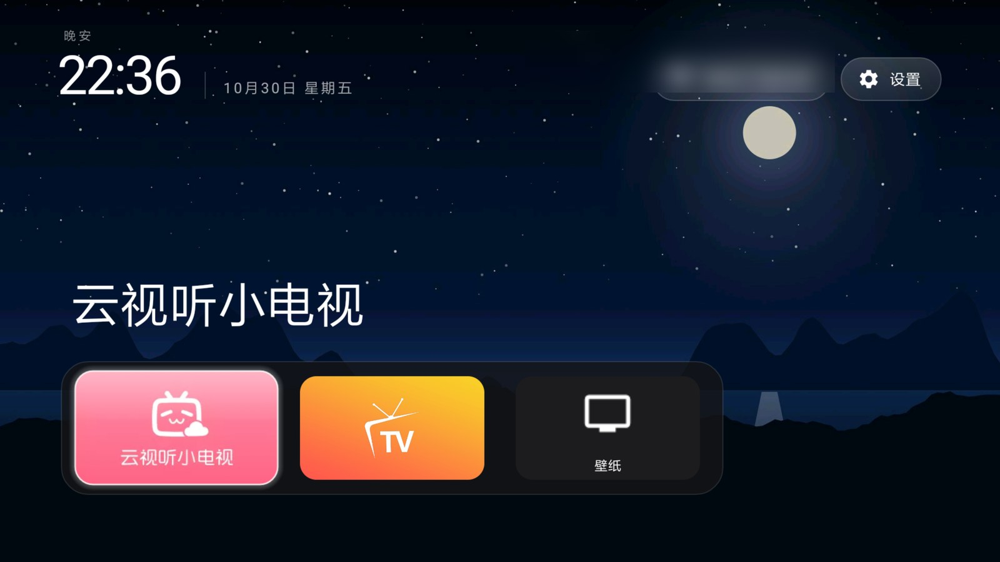
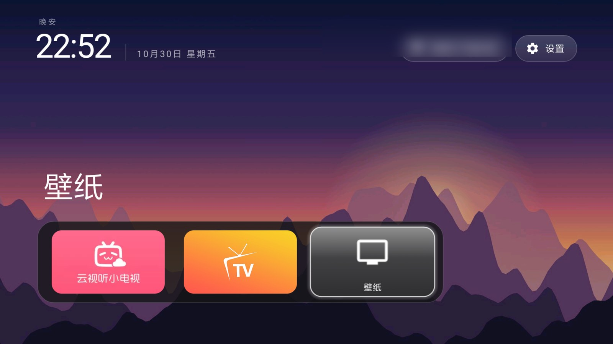

# MiTV2S-48 TV Home · Android 5.1 (API 22) 版 tvOS 风格桌面

把 [CleanYourTV](https://github.com/Gathin23/cleanyourtv) 的 tvOS 风格 launcher **移植到 Android 5.1 老电视**，
并记录一台小米电视 2S 48 的完整改造方法：系统精简（`pm hide`，可逆）、桌面接管、壁纸、设置入口。

在 Xiaomi **MiTV2S-48（gladiator，Android 5.1.1 / API 22）** 上实测通过：冷启动直接进入新桌面，
Home 键、应用启动、设置/Wi-Fi 胶囊、壁纸选择与轮换、还原流程都已验证，`logcat -b crash` 为空。




*截图里的 Wi-Fi 网络名已打码；壁纸来自上游 `tools/scenes_wallpapers.py` 生成的插画。*

## 为什么需要这个项目

| 问题 | 本仓库的做法 |
|---|---|
| 上游 launcher 的 `minSdk` 是 26（Android 8），这台电视只有 API 22 | 移植到 `minSdk 22`：开启 core library desugaring、修掉 48 处 `NewApi` 调用、关闭 R8（见 [docs/api22-port.md](docs/api22-port.md)） |
| 中国版小米固件拒绝 `pm disable-user`（每个包都报 `SecurityException`） | 改用 `pm hide`，可验证、可逆、重启保持；脚本见 `scripts/` |
| 固件在框架层强制自己的桌面，第三方桌面设为 Home 也不生效 | 隐藏小米桌面 `com.mitv.tvhome`，HOME 只剩新桌面；`pm unhide` 一条命令还原 |
| 「ADB 调试」开关只在小米设置里 | 设置胶囊直达厂商设置（`settings_pill_native`） |
| 需要一个能换壁纸的简洁首页 | 新增壁纸选择页（缩略图网格 / 每天轮换 / 无壁纸），Dock 加「壁纸」入口 |

## 功能

- **tvOS 风格首页**：问候语、细体时钟与日期、右上角毛玻璃胶囊、聚焦应用的彩色氛围光、底部 Dock
- **壁纸**：读取 `files/wallpapers/` 轮换（默认每天一张）、缩略图选择页、可关闭；Dock 的「壁纸」按钮打开选择页
- **桌面接管**：隐藏小米桌面后开机直接进简洁桌面；Home 键、应用返回都正常
- **系统精简**：42 个预装应用/广告/统计包的可逆隐藏清单（`lists/`）
- **24 小时制**：`settings put system time_12_24 24`
- **Dock**：默认两个应用（云视听小电视、影视仓）+ 壁纸按钮，可改 `launcher/app/src/main/res/values/config.xml`

## 环境要求

- 电视：Android 5.1（API 22）系列，实测 Xiaomi MiTV2S-48；能打开网络 ADB（同一 Wi-Fi 下 `adb connect <tv ip>:5555`）
- 构建：JDK 17、Android SDK platform 34 + build-tools 34.0.0（Gradle wrapper 会在首次构建时下载 Gradle 8.9）

## 构建

```bash
cd launcher
export JAVA_HOME=/path/to/jdk17
export ANDROID_HOME=/path/to/android-sdk
./gradlew assembleRelease
# APK: app/build/outputs/apk/release/app-release.apk（约 1.9 MB，debug 签名，仅供 sideload）
```

> 仓库**不提供预编译 APK**（与上游习惯一致）：请按上面的步骤自己构建，再装到自己的电视上。

## 安装与接管 Home

```bash
export TV_HOST=<tv ip>
scripts/install-launcher.sh launcher/app/build/outputs/apk/release/app-release.apk
# 先不要接管：在电视「我的应用」里打开「主屏幕」试用，确认正常后：
scripts/install-launcher.sh launcher/app/build/outputs/apk/release/app-release.apk --take-home
```

`--take-home` 会 `pm hide --user 0 com.mitv.tvhome`（只是隐藏，没有卸载），重启后仍然有效。
还原小米桌面：

```bash
adb -s <tv ip>:5555 shell pm unhide --user 0 com.mitv.tvhome
adb -s <tv ip>:5555 shell input keyevent 3
```

## 系统精简（可选、可逆）

```bash
scripts/hide.sh lists/01-ads-telemetry.txt
scripts/hide.sh lists/02-preloaded-apps.txt
scripts/hide.sh lists/03-account-cloud.txt
# 全部还原：
scripts/restore-all.sh
```

清单说明、必须保留的包、以及这台电视的其它坑（面板输入、投屏、字体、ADB 每次重启关闭）见
**[docs/mitv2s-48.md](docs/mitv2s-48.md)**。

## 壁纸

```bash
D=/sdcard/Android/data/com.gathin.tvhome/files
adb -s <tv ip>:5555 shell mkdir -p $D/wallpapers
adb -s <tv ip>:5555 push wallpapers/*.jpg $D/wallpapers/
adb -s <tv ip>:5555 push docs/wallpaper.example.json $D/config.json
```

`config.json` 支持 `wallpaper_rotation_minutes`（0–1440，1440 = 每天）、`wallpaper_order`
（`sequential` / `shuffle`）、`wallpaper_dim`、`dock_opacity` 等，格式与上游主题一致。
壁纸图可从上游 [`themes/`](https://github.com/Gathin23/cleanyourtv/tree/main/themes) 取用（注意上游
`CREDITS.md` 中的 CC BY / CC BY-SA 照片署名要求）。

## 已知限制

- 仅在 MiTV2S-48（Android 5.1.1）上实测；其它机型的固件差异需要自行验证
- **网络 ADB 每次重启/待机后关闭**（固件行为），用之前在小米设置里重新打开
- 这台电视 `TvInputManager` 没有任何输入，launcher 的 Inputs 菜单无法列出；信号源可用
  `am start -n com.xiaomi.mitv.tvplayer/.ExternalSourceActivity` 打开
- Outfit 字体在 Android 5.1 无法加载（`@font` XML family），文字回退系统字体；引入 AppCompat 可以解决，
  但那是一个新依赖，本项目没有加
- R8 混淆关闭（API 22 上 lambda 合成类会 `NoClassDefFoundError`），APK 约 1.9 MB

## English

A port of the [CleanYourTV](https://github.com/Gathin23/cleanyourtv) tvOS-style launcher to
**Android 5.1 (API 22)**, plus a tested recipe for a Xiaomi MiTV2S-48: reversible debloating with
`pm hide` (this firmware refuses `pm disable-user`), Home takeover by hiding the stock launcher, a
wallpaper picker with daily rotation, and vendor-settings access. Source only — build the APK
yourself (`launcher/`, JDK 17 + Android SDK 34). Screenshots' Wi-Fi name is blurred; no device
identifiers, firmware or APKs are included. MIT, based on CleanYourTV by Gathin.

## 许可与致谢

- MIT，见 [LICENSE](LICENSE)。
- launcher 源码、测试与资源来自 **[CleanYourTV](https://github.com/Gathin23/cleanyourtv)**
  （Copyright (c) 2026 Gathin，MIT）；本仓库的 API 22 移植、设备文档与脚本由 **lucas-sys** 完成。
  详见 [CREDITS.md](CREDITS.md)。
- 本项目与小米、腾讯、bilibili 等厂商无关；不包含任何固件、预编译 APK 或设备标识。
